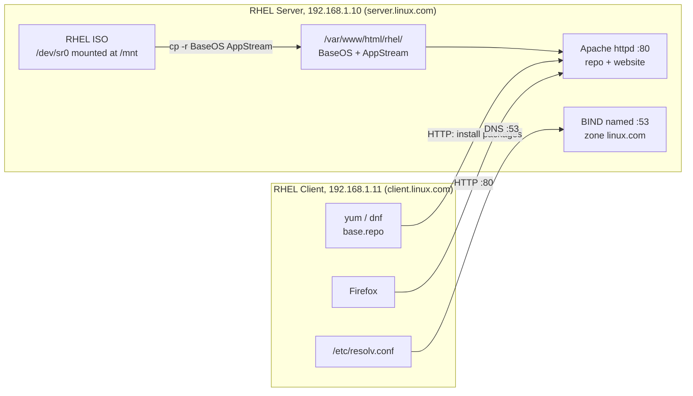

# Web Hosting Using Linux Commands: Local YUM Repository, DNS (BIND) and Apache HTTP on RHEL

A hands-on Linux system administration project that builds a small but complete **web-hosting infrastructure on Red Hat Enterprise Linux (RHEL)** using only command-line tools. Two virtual machines, a **server** and a **client**, are configured so that:

1. The server hosts a **local YUM/DNF package repository** (BaseOS + AppStream) served over HTTP, so machines with no internet or Red Hat subscription can still install software.
2. The server runs a **DNS server (BIND/named)** for the private domain `linux.com`, with forward and reverse lookup zones.
3. The server runs an **Apache HTTP web server** (`httpd`) that serves a site, reachable from the client by IP address and by name.

> Built as an internship project (VMware Workstation, RHEL). Every step was executed on real VMs; the original walkthrough with terminal screenshots is a PowerPoint deck (`HTTP.pptx`).

---

## Table of Contents

1. [Project Overview](#project-overview)
2. [Architecture](#architecture)
3. [Lab Environment](#lab-environment)
4. [Quick Reference](#quick-reference)
5. [Part 1: Local YUM Repository over HTTP](#part-1-local-yum-repository-over-http)
6. [Part 2: DNS Server with BIND](#part-2-dns-server-with-bind)
7. [Part 3: Apache HTTP Web Server](#part-3-apache-http-web-server)
8. [End-to-End Verification](#end-to-end-verification)
9. [Concepts Covered](#concepts-covered)
10. [Troubleshooting](#troubleshooting)
11. [Security Notes and Limitations](#security-notes-and-limitations)
12. [Possible Improvements](#possible-improvements)
13. [Skills Demonstrated](#skills-demonstrated)
14. [Author](#author)

---

## Project Overview

| | |
|---|---|
| **Goal** | Stand up the core services of a basic hosting environment on RHEL: package distribution, name resolution and web serving |
| **OS** | Red Hat Enterprise Linux (installed from ISO) |
| **Virtualization** | VMware Workstation (two VMs: `server` and `client`) |
| **Services** | `httpd` (Apache), `named` (BIND), YUM/DNF repository |
| **Network** | Private LAN `192.168.1.0/24`, domain `linux.com` |
| **Interface** | Command line only (bash, vim, systemctl, firewall-cmd) |

**Why it matters:** these three services (software distribution, DNS and HTTP) are the foundation of nearly every Linux server deployment. Doing all three by hand shows how they fit together: the repository is served by the web server, and the web server is reached through DNS.

## Architecture



**Bootstrapping order matters.** The server first builds a repository from the ISO using a `file://` path, which is how it installs `httpd` and `bind` with no internet. Once Apache is running, the same directory is exposed over HTTP and the client consumes it with an `http://` path.

## Lab Environment

| Item | Server | Client |
|---|---|---|
| Hostname | `server` (`server.linux.com`) | `client` (`client.linux.com`) |
| IP address | `192.168.1.10` | `192.168.1.11` |
| Role | Repo host, DNS, web server | Consumer of all three services |
| DNS suffix | `linux.com` | `linux.com` |

Prerequisites (not covered step by step here):
- Both VMs on the same virtual network with the static IPs above.
- The RHEL installation ISO attached to the server VM's virtual DVD drive.
- Root (or `sudo`) access on both machines.

## Quick Reference

| Item | Value |
|---|---|
| Web package / service | `httpd` |
| Web port | 80/tcp |
| Web config | `/etc/httpd/conf/httpd.conf` |
| Web document root | `/var/www/html` |
| DNS package / service | `bind` / `named` |
| DNS port | 53 (tcp/udp) |
| DNS config | `/etc/named.conf` |
| Zone files | `/var/named/forward.zone`, `/var/named/reverse.zone` |
| Repo files (server and client) | `/etc/yum.repos.d/server.repo`, `/etc/yum.repos.d/base.repo` |
| Repo content path | `/var/www/html/rhel/{BaseOS,AppStream}` |

---

## Part 1: Local YUM Repository over HTTP

**What YUM is:** a package manager (originally *Yellowdog Updater, Modified*, from Duke University) that installs, updates and removes RPM packages and resolves dependencies automatically. On modern RHEL, `yum` is an alias for `dnf`.

**Why build a local repo:** a freshly installed RHEL system that is not registered with Red Hat has no package source. Building a repo from the installation ISO gives you a working, offline package source that other machines can also use.

### Server side

```bash
# 1. Confirm the ISO is attached, then mount it
df -hT
mount /dev/sr0 /mnt

# 2. Create the web-served repo directory and copy the repo content
mkdir -p /var/www/html/rhel
cd /mnt
cp -r BaseOS AppStream /var/www/html/rhel/
cd ~

# 3. Define the repository for the server itself
vim /etc/yum.repos.d/server.repo
```

`/etc/yum.repos.d/server.repo`:

```ini
[BaseOS]
name=BaseOS
baseurl=file:///var/www/html/rhel/BaseOS
gpgcheck=0
enabled=1

[AppStream]
name=AppStream
baseurl=file:///var/www/html/rhel/AppStream
gpgcheck=0
enabled=1
```

```bash
# 4. Verify the repos are visible, then install Apache
yum repolist all -v
yum install httpd -y

# 5. Start Apache now and at boot, open the firewall, fix SELinux labels
systemctl restart httpd && systemctl enable httpd
firewall-cmd --permanent --add-service=http
firewall-cmd --reload
restorecon -Rv /var/www/html
```

### Client side

The client points at the server over **HTTP**:

```bash
vim /etc/yum.repos.d/base.repo
```

`/etc/yum.repos.d/base.repo`:

```ini
[BaseOS]
name=BaseOS
baseurl=http://192.168.1.10/rhel/BaseOS
gpgcheck=0
enabled=1

[AppStream]
name=AppStream
baseurl=http://192.168.1.10/rhel/AppStream
gpgcheck=0
enabled=1
```

```bash
yum repolist all -v      # both repos should appear as enabled
yum install httpd -y     # installs from the server's repo, proving it works
```

---

## Part 2: DNS Server with BIND

**Why DNS:** DNS translates names to IP addresses so users type `www.linux.com` instead of `192.168.1.10`. Here it provides name resolution for the private `linux.com` domain.

### Server side

```bash
yum install bind -y
vim /etc/named.conf
```

In `options { ... }` set the server to listen on its LAN address and answer queries:

```
listen-on port 53 { 192.168.1.10; };
allow-query       { any; };
```

At the end of the file, declare the forward and reverse zones:

```
zone "linux.com" {
    type master;
    file "forward.zone";
};

zone "1.168.192.in-addr.arpa" {
    type master;
    file "reverse.zone";
};
```

Create the zone files from the shipped templates (`-p` preserves ownership and permissions, which `named` needs):

```bash
cd /var/named
ls
cp -vp named.localhost forward.zone
cp -vp named.loopback  reverse.zone
```

`/var/named/forward.zone` (name to IP):

```
$TTL 1D
@       IN SOA  linux.com. root.server.linux.com. (
                        0       ; serial
                        1D      ; refresh
                        1H      ; retry
                        1W      ; expire
                        3H )    ; minimum
        IN NS   server.linux.com.
server.linux.com.   IN A      192.168.1.10
linux.com.          IN A      192.168.1.10
client.linux.com.   IN A      192.168.1.11
www.linux.com.      IN CNAME  server.linux.com.
@                   IN MX 10  server.linux.com.
```

`/var/named/reverse.zone` (IP to name):

```
$TTL 1D
@       IN SOA  linux.com. root.server.linux.com. (
                        0       ; serial
                        1D      ; refresh
                        1H      ; retry
                        1W      ; expire
                        3H )    ; minimum
        IN NS   server.linux.com.
10      IN PTR  server.linux.com.
11      IN PTR  client.linux.com.
```

Point the server at itself, start the service and open the firewall:

```bash
vim /etc/resolv.conf
#   search linux.com
#   nameserver 192.168.1.10

systemctl restart named && systemctl enable named
firewall-cmd --permanent --add-service=dns
firewall-cmd --reload

# Verify
nslookup server.linux.com      # or: dig server.linux.com
nslookup 192.168.1.10          # reverse lookup
```

### Client side

```bash
vim /etc/resolv.conf
#   search linux.com
#   nameserver 192.168.1.10

nslookup server.linux.com
nslookup 192.168.1.10
```

---

## Part 3: Apache HTTP Web Server

`httpd` was installed from the local repo in Part 1. Now it is configured to serve a site.

### Server side

```bash
vim /etc/httpd/conf/httpd.conf
```

Add a virtual host at the end of the file:

```apache
<VirtualHost *:80>
    ServerAdmin root@192.168.1.10
    DocumentRoot /var/www/html
    ServerName 192.168.1.10
    ErrorLog logs/server-error_log
    CustomLog logs/server-access_log combined
</VirtualHost>
```

```bash
httpd -t                                        # syntax check, expect "Syntax OK"
echo "welcome to web server" > /var/www/html/index.html
systemctl restart httpd && systemctl enable httpd
```

### Client side

```bash
firefox http://192.168.1.10
```

The browser should display `welcome to web server`.

---

## End-to-End Verification

| Check | Command | Expected result |
|---|---|---|
| ISO mounted | `df -hT` | `/dev/sr0` mounted on `/mnt` |
| Repos active | `yum repolist all -v` | `BaseOS` and `AppStream` enabled |
| Apache running | `systemctl status httpd` | `active (running)`, enabled |
| Apache config valid | `httpd -t` | `Syntax OK` |
| Firewall rules | `firewall-cmd --list-services` | includes `http` and `dns` |
| Forward DNS | `nslookup server.linux.com` | `192.168.1.10` |
| Reverse DNS | `nslookup 192.168.1.10` | `server.linux.com` |
| Client installs via repo | `yum install httpd -y` (client) | Packages fetched from `192.168.1.10` |
| Web page from client | `firefox http://192.168.1.10` | "welcome to web server" |

## Concepts Covered

| Term | Meaning in this project |
|---|---|
| **HTTP** | Application-layer protocol used to load web pages and, here, also to distribute RPM packages |
| **YUM / DNF** | Package manager that resolves dependencies and installs RPMs from configured repositories |
| **BaseOS / AppStream** | RHEL's two repositories: core OS packages and additional applications/runtimes |
| **SOA** | Start of Authority: metadata record for a DNS zone (primary server, admin contact, timers) |
| **NS** | Name server record: which server is authoritative for the zone |
| **A / CNAME** | A maps a name to an IP; CNAME makes one name an alias for another (`www` to `server`) |
| **MX** | Mail exchanger record: which host receives mail for the domain |
| **PTR** | Reverse record: maps an IP back to a name (in the `in-addr.arpa` zone) |
| **firewalld** | Host firewall managed with `firewall-cmd`; services opened permanently then reloaded |
| **SELinux** | `restorecon` resets file contexts so Apache may read the copied repo and web files |

## Troubleshooting

| Symptom | Likely cause and fix |
|---|---|
| `yum repolist` shows no repos | Typo in the `.repo` file, wrong path, or ISO not mounted. Re-check `baseurl` and run `mount /dev/sr0 /mnt` |
| "This system is not registered with an entitlement server" warning | Expected on an unregistered RHEL system. The local repo is the package source |
| Client cannot reach the repo | Firewall not open (`firewall-cmd --add-service=http`), `httpd` not running, or client `baseurl` uses `file://` instead of `http://<server-ip>/...` |
| Apache returns 403 Forbidden | SELinux labels wrong. Run `restorecon -Rv /var/www/html` |
| `systemctl enable http` fails | The service is `httpd`, not `http` |
| `named` fails to start | Run `named-checkconf` and `named-checkzone linux.com /var/named/forward.zone`. Look for missing dots at the end of names or missing semicolons |
| `nslookup` fails on the client | Wrong `nameserver` in `/etc/resolv.conf`, DNS port not open, or `named` not running. Note that NetworkManager can overwrite `resolv.conf`; set DNS on the connection with `nmcli` if it keeps resetting |
| Edited a zone but changes are not seen | Increase the SOA serial and run `systemctl restart named` |

## Security Notes and Limitations

This is a lab setup, so some choices would not be acceptable in production:

- `gpgcheck=0` disables package signature checks. Production repos should keep it on and import the RHEL GPG key.
- `allow-query { any; }` lets any host query the DNS server. Restrict it to the LAN, for example `{ 192.168.1.0/24; }`.
- The site is served over plain HTTP with no TLS.
- Repo clients and DNS rely on static IPs and manual configuration.
- The repository is a static copy of the ISO and receives no updates.

## Possible Improvements

- Enable HTTPS with `mod_ssl` and a certificate.
- Keep GPG checking enabled and publish the repo with `createrepo_c` for custom RPMs.
- Add a secondary (slave) DNS server and enable zone transfers.
- Use name-based virtual hosts for `www.linux.com` instead of an IP-based `ServerName`.
- Automate the whole build with a Bash script or Ansible playbook so it is repeatable.
- Mount the ISO persistently via `/etc/fstab`.
- Add monitoring of service health and Apache access/error logs.

## Skills Demonstrated

- Linux administration on RHEL: package management, services (`systemctl`), firewall (`firewalld`), SELinux basics
- Building an offline/local YUM-DNF repository and serving it over HTTP
- DNS design and configuration with BIND: forward and reverse zones, SOA/NS/A/CNAME/MX/PTR records
- Apache HTTP Server configuration and virtual hosts
- Client-server testing with `nslookup`, `dig`, `yum`, and a browser
- Working in VMware Workstation with multi-VM networking
- Troubleshooting configuration and syntax errors from the command line

## Author

**Piyush Bhadange**
[GitHub](https://github.com/bhadangepiyush-droid) | [LinkedIn](https://www.linkedin.com/in/piyush-bhadange-a8a01328b)

---

*Suggested repo layout:* `README.md`, `configs/` (server.repo, base.repo, named.conf excerpt, forward.zone, reverse.zone, httpd vhost), and `docs/` (the presentation and terminal screenshots).
